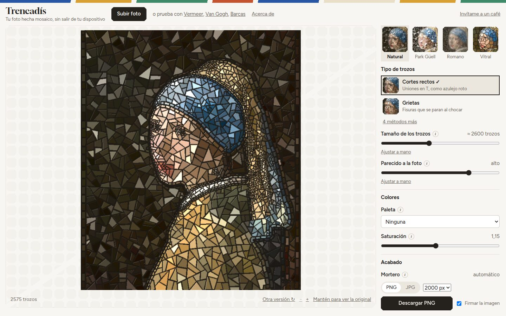

# Trencadís

[English](README.md)

Trencadís convierte una foto en un mosaico de azulejo roto, como los bancos del Park Güell de Barcelona. Todo se calcula en el navegador y la foto no sale de tu dispositivo.

Pruébalo en https://feal-ca.github.io/trencadis/



## Cómo se usa

La app abre con un cuadro de ejemplo ya convertido. Carga tu foto con «Subir foto», arrastrándola sobre la imagen o pegándola con Ctrl+V.

### El panel

El panel de la derecha empieza siendo sencillo:

- Los estilos de arriba (Natural, Park Güell, Romano, Vitral) sustituyen todos los ajustes con un clic, y se puede deshacer.
- «Tipo de trozos» elige el método de corte. Se ven dos, y «métodos más» enseña los otros cuatro.
- «Tamaño de los trozos», «Parecido a la foto» y «Brillo del esmalte» mueven varios parámetros a la vez. «Ajustar a mano» los muestra por separado, y «Volver al control simple» deshace el cambio.
- La paleta, la saturación y el color del mortero completan lo básico.

### Formas

Con tu propia foto, un modelo de segmentación (SlimSAM) busca los objetos que hay en ella. Con «Tocar una forma» pulsas un ojo, una cara o un pájaro y eliges más o menos detalle para esa forma. Las tres fotos de ejemplo traen sus formas ya calculadas y no necesitan descarga.

### Hileras

Las hileras son piezas rectangulares en fila a lo largo de una línea, como la espiral negra de los bancos de Gaudí. Salen de los contornos de las formas que ha encontrado el modelo. No hay hileras automáticas por bordes. También puedes dibujar tus propias líneas con «Dibujar hileras», a mano alzada o por puntos, y con «Pegar al contorno» la línea se acerca al borde más marcado cerca del cursor. «Ver las líneas» enseña todas las que se usan, y «Quitar la última» y «Quitar todas» borran las que has dibujado.

### Más ajustes

La sección «Más ajustes» reúne los cuatro pasos del algoritmo, cada uno con sus controles, una explicación en «¿Qué hace?» con la fórmula y «Ver este paso», que cambia la imagen grande por el resultado parcial de ese paso: 1 Detalle, 2 Trozos, 3 Colores y 4 Acabado. El icono ⓘ junto a cada control lo explica, y ↺ (solo aparece tras un cambio) lo devuelve a su valor de origen.

### Visor

La rueda amplía (Ctrl + rueda si hay una herramienta activa), arrastrar desplaza la imagen y la barra tiene botones de zoom. «Otra versión ↻» dibuja una distribución al azar nueva, y mantener pulsado «Mantén para ver la original» enseña la original nítida. Teclado: R para otra versión, espacio para ver la original, + − 0 para el zoom, D para descargar, y Ctrl+Z y Ctrl+Mayús+Z para deshacer y rehacer.

### Exportar

Descarga PNG o JPG al tamaño que elijas (el tamaño impreso equivalente aparece en la ayuda emergente de la opción de tamaño), o compártelo en el móvil. La imagen lleva una pequeña firma que puedes quitar. El acabado (junta, colocación, bisel, luz, brillo) se dibuja en la tarjeta gráfica y responde al momento. Los cambios de detalle, trozos o color se recalculan en segundo plano.

## Privacidad

- La foto se procesa en tu navegador y no se sube a ningún sitio.
- El modelo de segmentación viene de Hugging Face y su runtime ONNX de jsDelivr. Los dos se descargan la primera vez que buscas formas en tu propia foto (en escritorio con WebGPU empieza sola; el móvil y otros navegadores preguntan antes). Ninguna de las dos peticiones lleva la foto.
- La última sesión (foto, formas y líneas) se guarda en este navegador con IndexedDB, así que al recargar vuelve. Los ajustes van a localStorage.
- Esas dos descargas son las únicas peticiones que la app hace a otros sitios.

## Cómo funciona

1. Detalle. Se mide la energía de alta frecuencia D(x) = |L − desenfoque(L, σ)|, suavizada y normalizada. «Ignorar texturas» la rebaja donde la imagen está hecha de manchas: el determinante del Hessiano, dividido por el gradiente al cuadrado, es alto en puntos brillantes, hojas o césped y casi nulo a lo largo de un contorno. Las formas con más o menos detalle la suben o la bajan ahí. De ahí sale el tamaño de trozo s(x) = s_max − (s_max − s_min)·D(x)^γ, y del tensor de estructura, la dirección de los bordes θ(x). Los desenfoques son tres pasadas de box blur con el σ exacto (Kovesi). En imágenes grandes los mapas se calculan a media resolución y se interpolan, porque son suaves.
2. Trozos. Seis métodos:
   - Cortes rectos: la imagen se divide en azulejos irregulares (Voronoi) de unas 3,5 veces el tamaño de trozo, y cada azulejo se parte con rectas hasta llegar al tamaño pedido, así que ningún corte cruza la imagen. En cada corte se prueban N rectas y se elige una con probabilidad ∝ exp(−coste/T), donde el coste es la varianza de color que queda en las dos mitades más un castigo a las astillas. Salen uniones en T, como en el azulejo roto.
   - Grietas: inspirado en *Substrate* de Jared Tarbell. Cada grieta nace en un punto interior, lejos de otras grietas, y crece en los dos sentidos hasta chocar con otra. Los trozos más estrechos que el grosor mínimo se unen al vecino con el que comparten más borde (lo mismo se hace con las teselas alargadas y las manchas de color).
   - Teselas redondeadas: Voronoi con semillas de Poisson-disk de radio variable (Bridson) y relajación de Lloyd ponderada por 1/s(x)².
   - Teselas alargadas: Voronoi con una métrica estirada a lo largo de los bordes, como en Hausner (2001).
   - Teselas partidas: teselas redondeadas grandes que reciben unos pocos cortes rectos.
   - Manchas de color: superpíxeles SLIC con la separación tomada de s(x) y bordes simplificados con Douglas-Peucker.
   - Hileras, sobre cualquiera de los anteriores. Las guías salen de los contornos entre los objetos que ha encontrado el modelo de segmentación, más las líneas que dibujas. Las tuyas van primero. Las automáticas se procesan de la más larga a la más corta, y se quita cualquier tramo que caiga dentro de la banda de otra guía. Los extremos de tus líneas que quedan cerca de una automática se enganchan a ella. El ancho de las piezas es una fracción del tamaño de trozo de cada zona, suavizada a lo largo de la guía. Para cada píxel cerca de una guía, la distancia con signo y la posición a lo largo de ella dan la fila y la pieza, con filas vecinas desplazadas media pieza. El fondo se rasteriza, las hileras lo sobrescriben, cada fragmento suelto pasa a ser un trozo y los muy estrechos se unen a su vecino del fondo. Los trozos que ninguna hilera toca conservan su polígono original. Donde un trozo cruzaría dos objetos, se corta por su borde.
3. Color. Un color por trozo (media, más vivo, el más frecuente, mediana o el del centro), con paleta opcional (k-means de la foto o un juego fijo de azulejos de taller) y una pequeña variación al azar.
4. Acabado. En WebGL2: los trozos se triangulan con earcut y se dibujan con su índice, cada uno algo girado, desplazado y encogido según «Colocación a mano». Un jump flood da a cada píxel la distancia al borde más cercano, y el último pase pinta la junta, el bisel, la inclinación de cada trozo y un brillo Blinn-Phong. Si el navegador no tiene WebGL2, el mismo acabado se calcula en la CPU.

## Desarrollo

```
npm ci
npm run dev                  # servidor local
npm test                     # Vitest
npm run lint                 # ESLint con las reglas de hooks de React, sin avisos
npm run build                # sitio estático en dist/
npm run smoke                # prueba de humo en Chromium del sitio construido
npm run golden:update        # reescribe test/golden.json (solo si la geometría cambia a propósito)
node scripts/check-dist.mjs  # falla si dist/ lleva un WASM o pesa más de 3 MB
node scripts/shots.mjs       # capturas del build (escritorio, móvil, oscuro) en la carpeta temporal
node scripts/sample-segments.mjs  # recalcula las formas de los ejemplos (public/samples/*.seg.png)
node scripts/seg-bytes.mjs   # mide lo que descarga la primera búsqueda de formas
node scripts/bench.mjs       # tiempos por etapa en una imagen sintética
node scripts/thumbs.mjs      # regenera las miniaturas de los métodos
```

Los scripts que manejan un navegador usan `/usr/bin/chromium-browser`, o la ruta de la variable `CHROMIUM`.

Parámetros de la URL de la app:

- `?debug` expone `window.__trencadis` y guarda los tiempos de cada cálculo en `window.__runs`.
- `?nogl` salta WebGL2, para probar el camino en CPU.
- `?samDevice=wasm` (o `webgpu`) fuerza el dispositivo donde corre el modelo de segmentación. `?segBatch=N` y `?segPoints=N` cambian su tamaño de lote y su número de puntos.

`test/golden.json` guarda un hash de la geometría de cada método con semilla fija, así que cualquier cambio no buscado aparece como un test que falla. La CI (`.github/workflows/ci.yml`) ejecuta lint, tests, build, la comprobación del tamaño de `dist/` y la prueba de humo; el workflow de despliegue la llama y publica en GitHub Pages solo si pasa.

El código de imagen está en `src/core/` y no depende del DOM, salvo `vis.js`, que dibuja las etapas con OffscreenCanvas. La forma de los datos principales (Shard, Zone, Region, Parts, Segments) está documentada en JSDoc en `src/core/types.js`. El cálculo corre en un Web Worker (`src/worker.js`), el render en `src/gl/` y la segmentación en `src/seg/`. La interfaz en React está en `src/ui/`; los pasos y sus textos, en `src/ui/steps.js`, y la ayuda de cada parámetro, en `src/core/params.js`. Por ahora la interfaz está solo en castellano.

## Créditos

- Los cuadros de ejemplo son de dominio público y vienen de Wikimedia Commons: *La joven de la perla*, de Johannes Vermeer (c. 1665), y *La noche estrellada*, de Vincent van Gogh (1889). La foto de las barcas es «El Guamache Bay, Margarita island», también de Wikimedia Commons, con licencia CC0.
- A. Hausner, «Simulating Decorative Mosaics», SIGGRAPH 2001.
- R. Achanta et al., «SLIC Superpixels Compared to State-of-the-Art Superpixel Methods», IEEE TPAMI 2012.
- J. Tarbell, *Substrate* (2003).
- R. Bridson, «Fast Poisson Disk Sampling in Arbitrary Dimensions», SIGGRAPH 2007 sketches.
- P. Kovesi, «Fast Almost-Gaussian Filtering», DICTA 2010.
- G. Rong y T.-S. Tan, «Jump Flooding in GPU with Applications to Voronoi Diagram and Distance Transform», I3D 2006.
- P. Felzenszwalb y D. Huttenlocher, «Distance Transforms of Sampled Functions», 2012 (render en CPU).

Licencia MIT.
